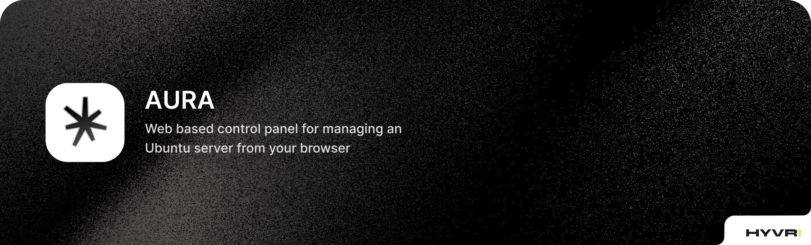

**Aura** is a web-based control panel for managing an Ubuntu server from your browser. It lets you manage Docker containers, Git repositories, Nginx sites, backups, files and more, all in one place. Aura is written in Go and uses HTML, Javascript for the UI. It ships as a **single binary** with all templates and assets built in. It stores its data in a local SQLite database and runs on port **8445**.

## :zap: Features

- **Dashboard**: live system stats such as CPU, memory and disk usage.
- **Docker Containers**: list, start, stop, restart and delete containers, view logs and open an interactive shell.
- **Docker Volumes**: create and delete volumes.
- **Projects**: deploy Docker Compose projects from your repositories with pull, deploy and down actions.
- **Git Repositories**: clone, pull and switch branches, with a separate SSH deploy key for each repository.
- **Web Server (Nginx)**: create, edit, enable and disable sites, get free SSL certificates with Certbot and view site logs.
- **Backups**: scheduled backups (daily at 00:00 through cron) stored locally or on AWS S3, with automatic cleanup of old backups, run history and manual runs.
- **File Manager**: browse, create, rename, edit, delete and download files on the server.
- **Console**: a web terminal for the server, plus saved commands you can run again later.
- **Settings**: system checks that show the status of every required package and service.
- **Dark, responsive UI**: works on desktop, tablet and mobile.

## :gear: Requirements

- Ubuntu server (x86_64 or arm64)
- Root or `sudo` access
- systemd

## :rocket: Installation & usage

### Install

Download the install script and run it as root:

```bash
wget -O install.sh https://raw.githubusercontent.com/hyvr-official/aura/master/install.sh
sudo bash install.sh
```

The script will:

1. Download the latest Aura release for your server's architecture.
2. Install it to `/opt/aura`.
3. Create and start the `aura` systemd service.
4. Print the URL to finish the setup.

### Automatic dependency setup

You don't need to install anything else by hand. Each time Aura starts, it checks for the tools it needs and **installs any that are missing** using `apt`:

- Docker (with Docker Compose v2)
- Git
- Nginx
- Certbot (with the Nginx plugin)
- Cron
- 7-Zip (`p7zip-full`)
- OpenSSH client

It also makes sure the Nginx and Docker services are running. You can see the results, and run the checks again, from the **Settings** page.

### First-time setup

1. Open `http://<your-server-ip>:8445/setup` in your browser.
2. Create your admin password.
3. Log in and start managing your server.

### Managing the service

Useful commands:

```bash
systemctl status aura      # Check the service status
journalctl -u aura -f      # Follow the logs
systemctl restart aura     # Restart Aura
```

To **update** Aura, run the install script again. Your data is kept.

### Configuration

Aura can be configured with environment variables, set in the systemd service or in a `.env` file kept in the base of the project `/opt/aura`. Restart the service with `systemctl restart aura` after changing the .env file.

| Variable          | Default   | Description                               |
| ----------------- | --------- | ----------------------------------------- |
| `AURA_DB_PATH`    | `aura.db` | Path to the SQLite database file.         |
| `AURA_FILES_ROOT` | `/`       | Root folder shown in the File Manager.    |

## :hammer_and_wrench: How to build
You can build the binaries or do development of Aura by following the below steps. Aura is build fully on Golang and Goreleaser is used for building releases. So you should install latest version of Go from [here](https://go.dev/doc/install).

* Clone that project from Github.
* Run `go mod download` command to install all mods.
* Install Goreleaser by running `go install github.com/goreleaser/goreleaser/v2@latest`
* Run `build.bash` if you are building from Linux.
* Run `build.bat` if you are building from Windows.
* Build will be generated in the `./dist` folder

## :page_with_curl: License

Aura is open-source software licensed under the [MIT License](LICENSE).
